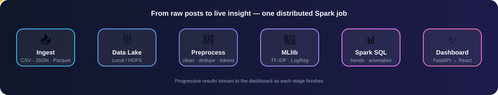
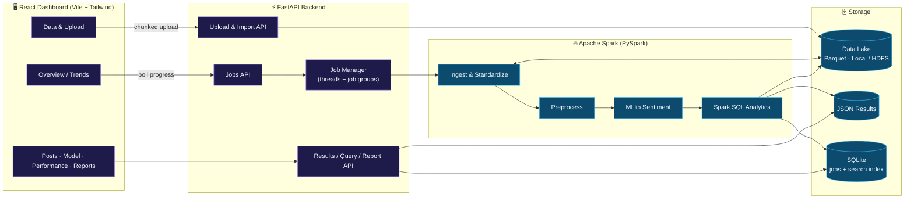
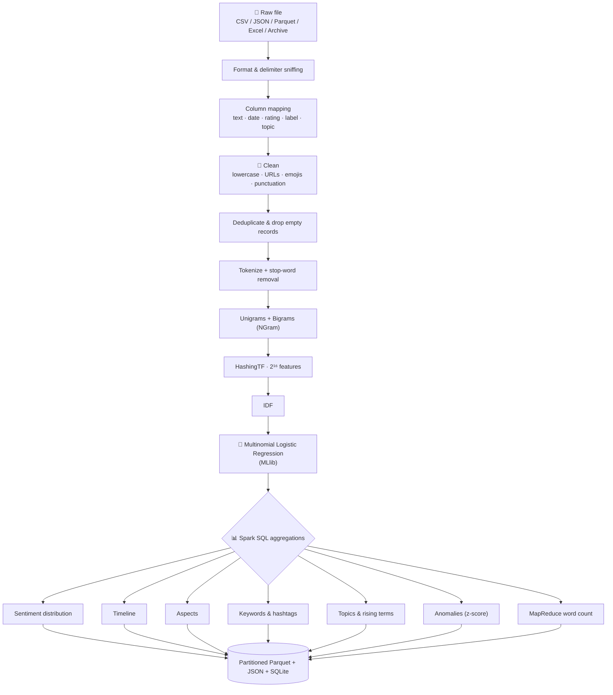
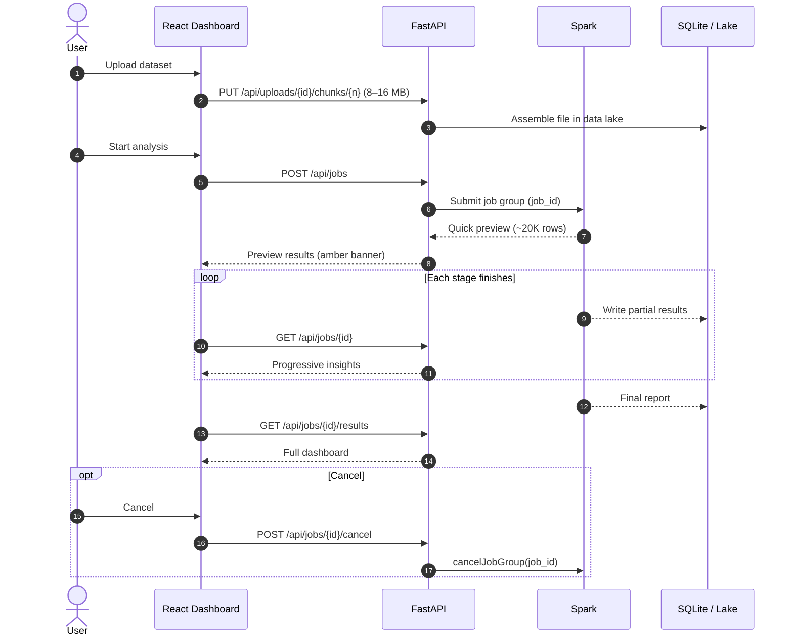
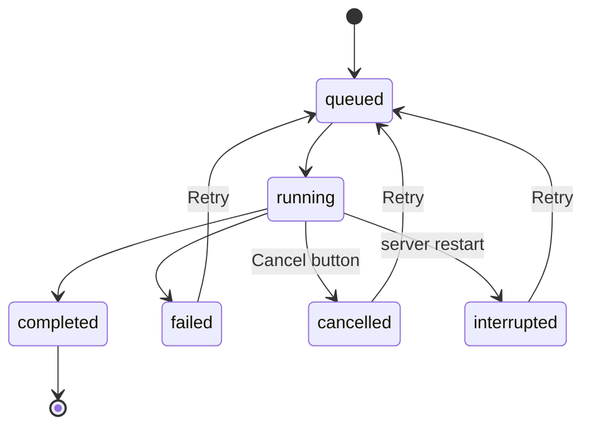
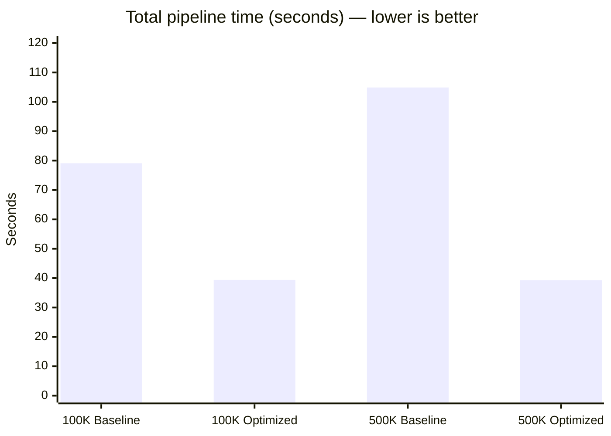
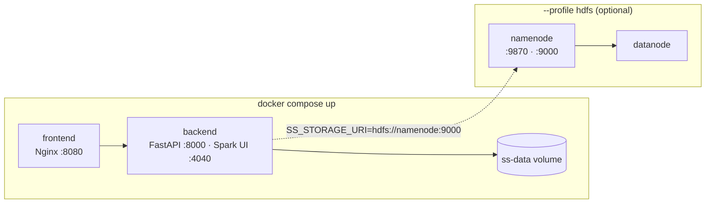
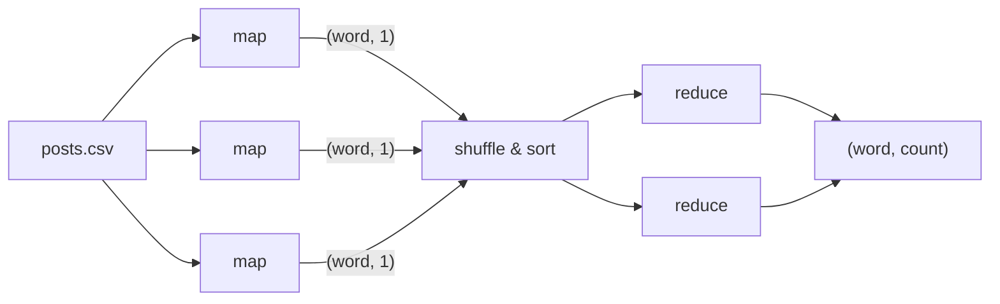

<div align="center">



<a href="https://github.com/LoganthP/SentimentStream">
  
</a>

<br/>

**A Distributed Big Data Analytics Framework for Social Media Sentiment Classification and Emerging Trend Detection Using Apache Spark**


<br/>


<br/>


<br></br>

[Overview](#-overview) •
[Features](#-features) •
[Architecture](#%EF%B8%8F-architecture) •
[Tech Stack](#-tech-stack) •
[Benchmarks](#-performance-before-vs-after-optimization) •
[Setup](#-getting-started) •
[Big Data Modules](#-big-data-modules-hdfs--hive--mapreduce--streaming) •
[API](#-rest-api) •
[Troubleshooting](#-troubleshooting)

</div>


## 🌊 Overview

**SentimentStream** lets you upload massive collections of social media posts or product reviews, run a distributed **Apache Spark** job over them, and explore the results in a modern web dashboard:

- 😊 😐 😠 **Sentiment** — positive / neutral / negative classification with confidence scores
- 🔧 **Feature-level complaints** — which product aspects attract the most negativity
- 🔥 **Trending words, hashtags & rising terms** — what people are suddenly talking about
- 📉 **Negative spikes** — z-score anomaly detection on the sentiment timeline
- ⚡ **Spark performance** — stage timings, partitions, jobs and throughput, live

<div align="center">

</div>


## ✨ Features

<table>
<tr>
<td width="50%" valign="top">

### 📥 Ingestion
- **Universal formats** — CSV, TSV, TXT, JSON array, JSON-lines, NDJSON, Parquet, Excel `.xlsx`, `.gz` / `.bz2`, `.zip` / `.tar.gz`
- **Smart sniffing** — auto-detects `,` `;` `\t` `|` delimiters, headers and encodings (`utf-8`, `utf-8-sig`, `cp1252`, `latin-1`)
- **Resumable chunked uploads** — 8–16 MB chunks streamed to disk with live MB/s, ETA, cancel and auto-retry
- **Import from URL or server / HDFS path** — pull multi-GB files without the browser

</td>
<td width="50%" valign="top">

### 🧭 Data Preparation
- **Preview & column mapping** — inspect the first 20 rows, override text / date / rating / label / topic columns
- **Combine text fields** — e.g. `Summary + Text` into one analysis column
- **Plain-language guidance** when a file doesn't look like text data
- **Kaggle-ready** — auto-detects Airline, Amazon Fine Food, Sentiment140, Yelp and Datafiniti layouts

</td>
</tr>
<tr>
<td width="50%" valign="top">

### ⚡ Spark Engine
- **Warm start** — Spark boots and warms up in the background on server start
- **Quick Preview Mode** — 20K-row sample results in ~15–20 s while the full job runs
- **Parallel CSV splits** via automatic quoted-newline detection
- **Adaptive Query Execution** with partition coalescing, 2¹⁶ hashing features, DataFrame-native word counts

</td>
<td width="50%" valign="top">

### 🛡️ Reliability & UX
- **Progressive results** — cleaning stats → distribution → timeline → aspects & keywords → full report
- **Live cancellation** via `sparkContext.cancelJobGroup`
- **Restart survival** — interrupted jobs are flagged and retried in one click
- **Reports, post explorer & model page** — search indexed posts, retrain, run ad-hoc predictions

</td>
</tr>
</table>


## 🏗️ Architecture

### System overview



### Spark processing pipeline



### Job lifecycle



### Job states




## 🧰 Tech Stack

| Layer | Technology | Role in SentimentStream |
|---|---|---|
| **Distributed compute** |  | Core processing engine (PySpark DataFrames, RDD word count, AQE) |
| **Machine learning** |  | NGram → HashingTF → IDF → multinomial Logistic Regression |
| **Analytics** |   | Aggregations, trends, anomalies; Hive scripts over processed Parquet |
| **Storage** |    | Data lake (local or HDFS), columnar outputs, job metadata & search index |
| **Batch processing** |  | Classic mapper / reducer word count for comparison with Spark |
| **Backend** |    | REST API, chunked uploads, job orchestration |
| **Data utilities** |     | Arrow transfer, numerics, Excel streaming, system monitoring |
| **Frontend** |    | SPA dashboard with landing page and `/app` routes |
| **UI & charts** |      | Styling, animation, charts, icons |
| **Testing** |   | Pipeline/API tests and end-to-end regression |
| **DevOps** |   | One-command stack, optional HDFS profile, static frontend serving |


## 🚀 Performance: Before vs. After Optimization

> Evaluated on an **8-core CPU / 16 GB RAM** machine.



| Dataset | Metric | Baseline | Optimized | Improvement |
|---|---|---|---|---|
| **100K rows** (14.7 MB) | Total time | 79.11 s | **39.41 s** | 🟢 **2.01× faster** |
| | Throughput | 1,264 rows/s | **2,537 rows/s** | 🟢 **2.01×** |
| | Spark partitions | 1 (single core) | **4** | Multi-core parallel |
| | Preprocessing | 24.70 s | **5.28 s** | 🟢 **4.68× faster** |
| | MapReduce word count | 14.88 s | **0.84 s** | 🟢 **17.71× faster** |
| **500K rows** (73.6 MB) | Total time | 104.90 s | **39.32 s** | 🟢 **2.67× faster** |
| | Throughput | 4,766 rows/s | **12,715 rows/s** | 🟢 **2.67×** |
| | Spark partitions | 1 (single core) | **8** | Full multi-core split |
| | Preprocessing | 55.04 s | **8.13 s** | 🟢 **6.77× faster** |
| | Analytics stage | 28.01 s | **7.69 s** | 🟢 **3.64× faster** |
| | MapReduce word count | 19.30 s | **0.85 s** | 🟢 **22.71× faster** |
| | Spark jobs | 81 | **63** | 18 fewer passes |

<details>
<summary><b>🔬 What changed?</b></summary>

<br/>

| Optimization | Effect |
|---|---|
| Quoted-newline detection | Lets Spark split CSVs across cores instead of reading as one partition |
| Adaptive Query Execution + partition coalescing | Right-sizes shuffle partitions at runtime |
| 2¹⁶ HashingTF features | Smaller feature vectors, faster training and inference |
| DataFrame-native word count | Replaces slow Python RDD lambdas with Catalyst-optimized operations |
| Fewer redundant passes | 81 → 63 Spark jobs on the 500K dataset |

Reproduce the numbers with `python -m scripts.measure_baseline` and `python -m scripts.measure_optimized` from `backend/`.

</details>


## 📁 Supported Formats & Size Limits

| Format | Extensions | Handling | Notes |
|---|---|---|---|
| Delimited text | `.csv` `.tsv` `.txt` | Delimiter sniffer (`,` `;` `\t` `\|`) + quoted-newline detector | Splittable multi-core read when there are no quoted newlines |
| JSON | `.json` `.jsonl` `.ndjson` | JSON lines or JSON array | Nested objects handled automatically |
| Parquet | `.parquet` | Native columnar Spark read | Keeps schema and pushdown filters |
| Excel | `.xlsx` | Read-only streaming via `openpyxl` | Converted server-side to CSV |
| Compressed | `.gz` `.bz2` | Native Spark decompression | `.bz2` is splittable |
| Archives | `.zip` `.tar.gz` `.tgz` | Server-side extraction | Candidate data files picked automatically |

- **Default max file size:** 10 GB (`SS_MAX_UPLOAD_SIZE`)
- **Disk safety:** free space is verified before accepting chunks or streams


## 🛠️ Getting Started

### Prerequisites

| Tool | Version | Check with |
|---|---|---|
|  | **3.11** (PySpark 3.5.3 supports 3.8–3.11; 3.13+ is incompatible) | `python --version` |
|  | **11, 17 or 21 LTS** (23+ unsupported — `Subject.getSubject` removed) | `java -version` |
|  | **18+** | `node --version` |
|  | Optional, for the containerized setup | `docker --version` |

> [!IMPORTANT]
> Spark needs Java. Make sure **JDK 11, 17 or 21** is installed and **`JAVA_HOME`** points to it.

> [!NOTE]
> **Windows users:** native runs need `winutils.exe` and `hadoop.dll` (Hadoop 3.3.5). They are already shipped in `backend/hadoop/bin`, or you can place them in `C:\hadoop\bin`. The backend discovers installed JDKs and local Hadoop paths automatically.

### 1️⃣ Clone the repository

```bash
git clone https://github.com/LoganthP/SentimentStream.git
cd SentimentStream
```

### 2️⃣ Backend — FastAPI + Spark

```bash
cd backend
python -m venv .venv

# Windows PowerShell
.venv\Scripts\Activate.ps1
# Linux / macOS
source .venv/bin/activate

pip install -r requirements.txt
uvicorn app.main:app --reload --port 8000
```

| Service | URL |
|---|---|
| REST API | http://localhost:8000 |
| Interactive API docs (Swagger) | http://localhost:8000/docs |
| Spark UI | http://localhost:4040 |

> [!TIP]
> Watch the status indicator in the bottom-left of the dashboard: it shows **“Spark warming up…”** on startup and switches to **“Spark ready”** once the session is initialized.

### 3️⃣ Frontend — React + Vite + Tailwind

Open a second terminal:

```bash
cd frontend
cp .env.example .env        # sets VITE_API_URL=http://localhost:8000
npm install
npm run dev
```

🎉 Open **http://localhost:5173** — the landing page lives at `/`, the analytics app at `/app`.

### 4️⃣ (Optional) Generate a sample dataset & train the model

```bash
cd backend
python -m scripts.generate_sample_data --rows 100000     # synthetic "Nova X5" launch dataset
python -m scripts.train_model                             # train default classifier
python -m scripts.train_model --file path/to/reviews.csv --name default_lr   # train on your own labeled data
```

### 🐳 Alternative: Docker Compose

```bash
docker compose up --build
```

| Service | URL |
|---|---|
| Dashboard | http://localhost:8080 |
| API | http://localhost:8000 |
| Spark UI | http://localhost:4040 |

**With an HDFS data lake:**

```bash
cp .env.example .env        # SS_STORAGE_URI=hdfs://namenode:9000/sentimentstream
docker compose --profile hdfs up --build
```

The HDFS NameNode UI is then available at http://localhost:9870.




## 🐘 Big Data Modules: HDFS · Hive · MapReduce · Streaming

<details>
<summary><b>🗺️ MapReduce word count (Hadoop Streaming)</b></summary>

<br/>

A classic `mapper.py` / `reducer.py` pair in [`mapreduce/`](mapreduce/) for comparison with Spark's `map → reduceByKey` version.

**Local simulation (no Hadoop needed):**

```bash
cd mapreduce
python mapper.py < ../backend/data/samples/nova_100000.csv | sort | python reducer.py | sort -k2,2nr | head -20
```

Running on the Docker HDFS cluster is documented in [`mapreduce/README.md`](mapreduce/README.md) (requires adding YARN ResourceManager/NodeManager images).



</details>

<details>
<summary><b>🐝 HiveQL analytics</b></summary>

<br/>

[`hive/sentimentstream.hql`](hive/sentimentstream.hql) defines an external `posts` table over the processed Parquet output and runs queries for sentiment distribution, daily trends, word frequency, aspect-level negativity, trending hashtags and topic comparison.

```bash
# Replace JOB_ID in the script with a real job id from the dashboard
hive -f hive/sentimentstream.hql
# or, without a Hive install:
spark-sql -f hive/sentimentstream.hql
```

</details>

<details>
<summary><b>📡 Near-real-time Structured Streaming demo</b></summary>

<br/>

Watches a folder for new CSV files, classifies each post with the trained model and prints 5-minute windowed sentiment counts.

```bash
cd backend
# Terminal 1 — drops a small CSV of new posts every 5 seconds
python -m scripts.stream_demo --feed data/stream_in
# Terminal 2 — streaming classifier
python -m scripts.stream_demo --watch data/stream_in
```

</details>


## 🔄 Preview vs. Full Analysis

```mermaid
gantt
    title Typical run on a large dataset
    dateFormat ss
    axisFormat %Ss
    section Quick preview
    Sample ~20K posts & classify      :p1, 00, 18s
    section Full job (progressive)
    Row counts & cleaning stats       :f1, 00, 12s
    Sentiment distribution & timeline :f2, after f1, 10s
    Aspects, keywords & topics        :f3, after f2, 9s
    Anomalies & MapReduce word count  :f4, after f3, 8s
```



<sub>Timings are illustrative; the order of stages is what the dashboard follows.</sub>

- **Quick Preview Mode** — for datasets with more than 30,000 posts, a sample (~20,000 posts or 5%) is classified with the pretrained model and shown on the Overview page within **15–20 s**, marked with an amber banner.
- **Progressive stream** — full results replace the preview stage by stage: cleaning stats → sentiment & timeline → aspects, keywords & topics → anomalies & word count.
- **Live cancellation** — the **Cancel** button triggers `sparkContext.cancelJobGroup(job_id)` immediately.


## 🔌 REST API

Full interactive docs are at **`/docs`**. Main endpoints:

| Method | Endpoint | Purpose |
|---|---|---|
| `GET` | `/api/health` | Health & Spark readiness |
| `POST` | `/api/uploads` | Start a resumable chunked upload |
| `PUT` | `/api/uploads/{upload_id}/chunks/{index}` | Upload one chunk |
| `POST` | `/api/uploads/{upload_id}/complete` | Assemble the uploaded file |
| `POST` | `/api/datasets/import` | Import from URL or server / HDFS path |
| `GET` | `/api/datasets/{ds_id}/preview` | First rows + detected column mapping |
| `POST` | `/api/datasets/sample` | Generate a sample dataset |
| `POST` | `/api/jobs` | Start an analysis job |
| `GET` | `/api/jobs/{job_id}` | Job status & progressive results |
| `POST` | `/api/jobs/{job_id}/cancel` · `/retry` | Cancel or retry a job |
| `GET` | `/api/jobs/{job_id}/results` | Full analytics results |
| `POST` | `/api/jobs/{job_id}/query` | Run a query over job output |
| `GET` | `/api/jobs/{job_id}/posts` | Search the indexed posts |
| `GET` | `/api/jobs/{job_id}/report` | Downloadable report |
| `POST` | `/api/benchmarks` · `GET /api/benchmarks/latest` | Run / view Spark benchmarks |
| `GET` · `POST` | `/api/model` · `/api/model/train` | Model info & retraining |
| `POST` | `/api/predict` | Classify ad-hoc text |


## ⚙️ Configuration

All tuning knobs are environment variables:

| Variable | Default | Purpose |
|---|---|---|
| `SPARK_DRIVER_MEMORY` | Auto (~50% RAM, up to `8g`) | JVM heap for the Spark driver |
| `SPARK_SHUFFLE_PARTITIONS` | Auto — `max(4, 2 × CPU cores)` | Target shuffle partitions |
| `SPARK_MASTER` | `local[*]` | `local[*]` or `spark://host:7077` |
| `SS_MAX_UPLOAD_SIZE` | `10737418240` (10 GB) | Max upload size in bytes |
| `SS_STORAGE_URI` | empty → `backend/data/lake` | Local lake folder or `hdfs://namenode:9000/...` |
| `SS_EXPLORER_LIMIT` | `10000` | Sample rows indexed into SQLite for instant search |
| `VITE_API_URL` | `http://localhost:8000` | Backend URL used by the frontend |


## 📂 Project Structure

```text
SentimentStream/
├── backend/
│   ├── app/
│   │   ├── main.py              # FastAPI routes
│   │   ├── jobs.py              # Job manager, cancel / retry
│   │   ├── spark_session.py     # Spark config, warm start, AQE
│   │   ├── monitor.py           # System & Spark metrics
│   │   ├── reports.py · db.py · config.py
│   │   └── pipeline/
│   │       ├── ingest.py        # Format sniffing & standardization
│   │       ├── preprocess.py    # Cleaning, dedupe, tokenization
│   │       ├── sentiment.py     # TF-IDF + Logistic Regression
│   │       ├── trends.py        # Aggregations, anomalies, word count
│   │       ├── benchmark.py · synth.py
│   ├── scripts/                 # sample data, training, benchmarks, streaming demo
│   ├── tests/                   # pytest suites
│   ├── hadoop/bin/              # winutils.exe + hadoop.dll for Windows
│   ├── requirements.txt · Dockerfile
├── frontend/
│   ├── src/
│   │   ├── pages/               # Landing, Overview, Data, Trends, Posts, Model, Performance, Reports
│   │   ├── components/          # UI kit, charts, landing sections, theme toggle
│   │   └── lib/                 # API client, app state, formatters
│   ├── e2e/                     # Playwright regression tests
│   ├── package.json · vite.config.js · tailwind.config.js · nginx.conf · Dockerfile
├── hive/sentimentstream.hql     # HiveQL analytics
├── mapreduce/                   # Hadoop Streaming mapper & reducer
├── docker-compose.yml
└── .env.example
```


## 🧪 Testing

```bash
# Backend
cd backend
pytest tests/ -v

# Frontend production build
cd frontend
npm run build
```

The pipeline suite checks:

1. ✅ Column detection for common Kaggle formats (Airline, Amazon Fine Food, Sentiment140, Yelp, Datafiniti)
2. ✅ Delimiter & encoding sniffing (`utf-8`, `utf-8-sig`, `latin-1`)
3. ✅ Resumable chunked upload assembly
4. ✅ End-to-end 5K-row analysis with result-schema validation


## 🩺 Troubleshooting

<details>
<summary><code>UnsupportedOperationException: getSubject is not supported</code></summary>

Spark 3.5.3 doesn't work with Java 23+. Install JDK **11, 17 or 21** and set `JAVA_HOME`.
</details>

<details>
<summary><code>OutOfMemoryError</code> on large files</summary>

Give the driver more heap, e.g. `SPARK_DRIVER_MEMORY=8g`.
</details>

<details>
<summary><code>winutils.exe</code> / <code>HADOOP_HOME</code> missing on Windows</summary>

Make sure `winutils.exe` and `hadoop.dll` are in `backend\hadoop\bin` or `C:\hadoop\bin`.
</details>

<details>
<summary><code>This file has no column that looks like text</code></summary>

Use the **Mapping** button on the Data page to pick the text column manually.
</details>

<details>
<summary>Server stopped during a job</summary>

The job is shown with an amber **interrupted** badge — click **Retry** to run it again.
</details>

<details>
<summary>Dashboard says “Spark warming up…”</summary>

Normal on startup — it switches to **“Spark ready”** once the session is initialized.
</details>

